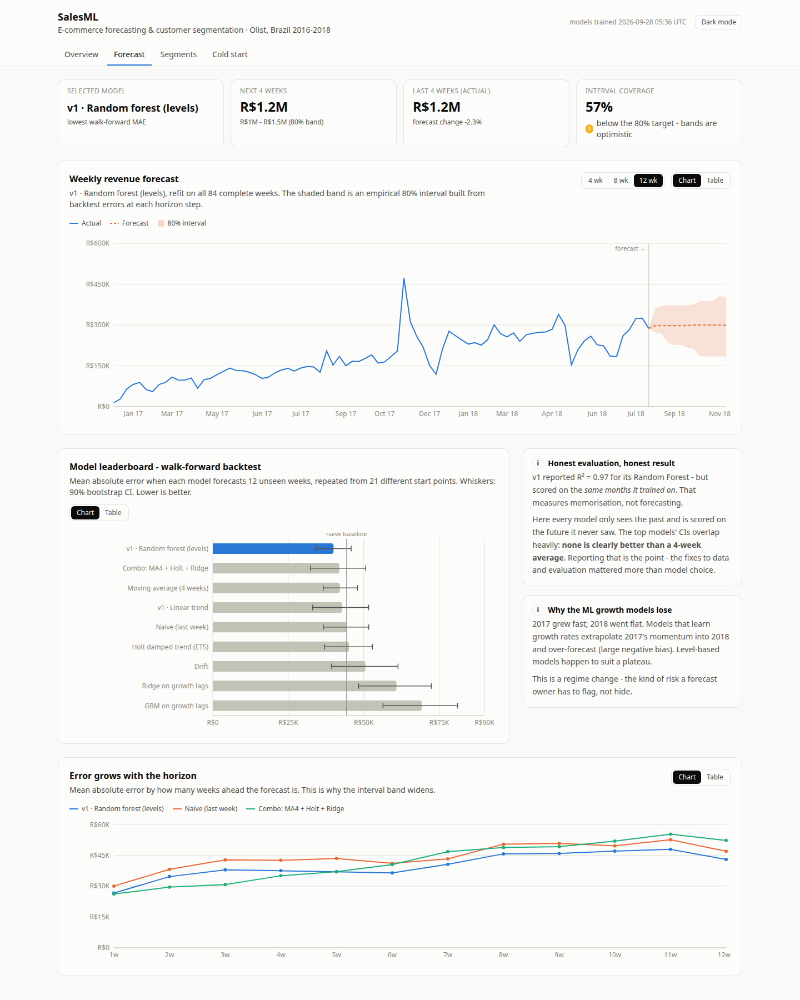
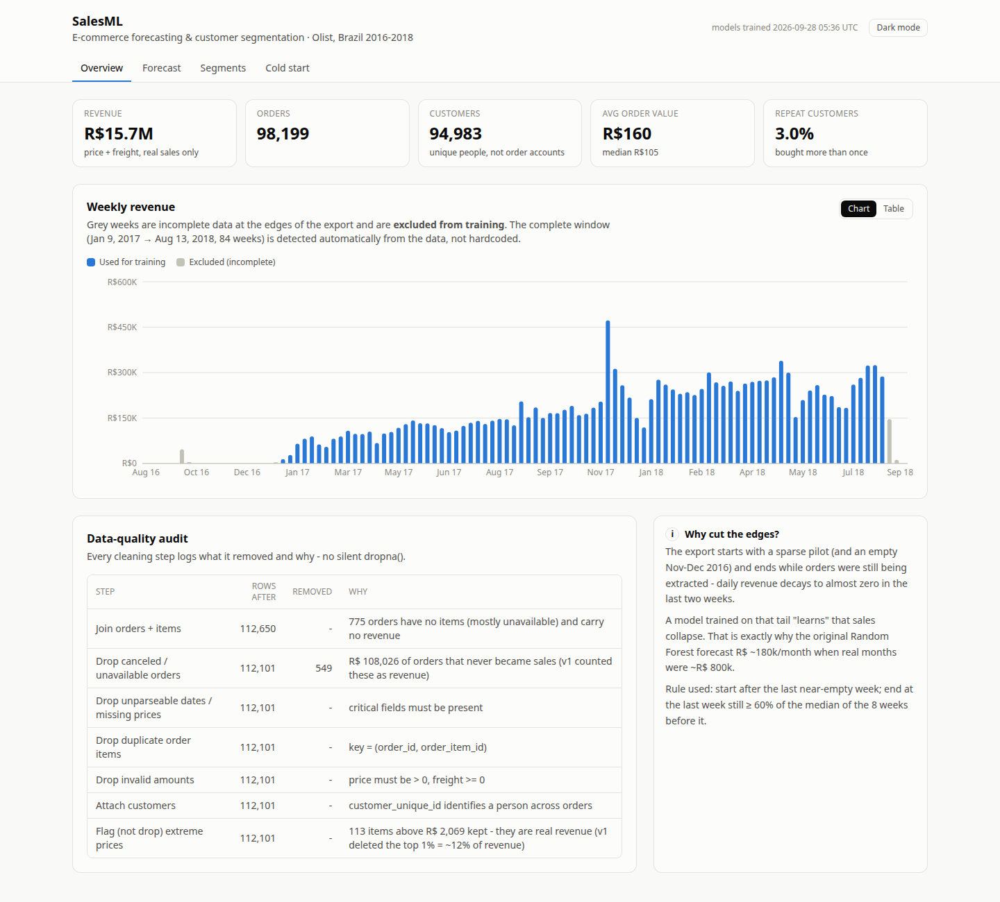
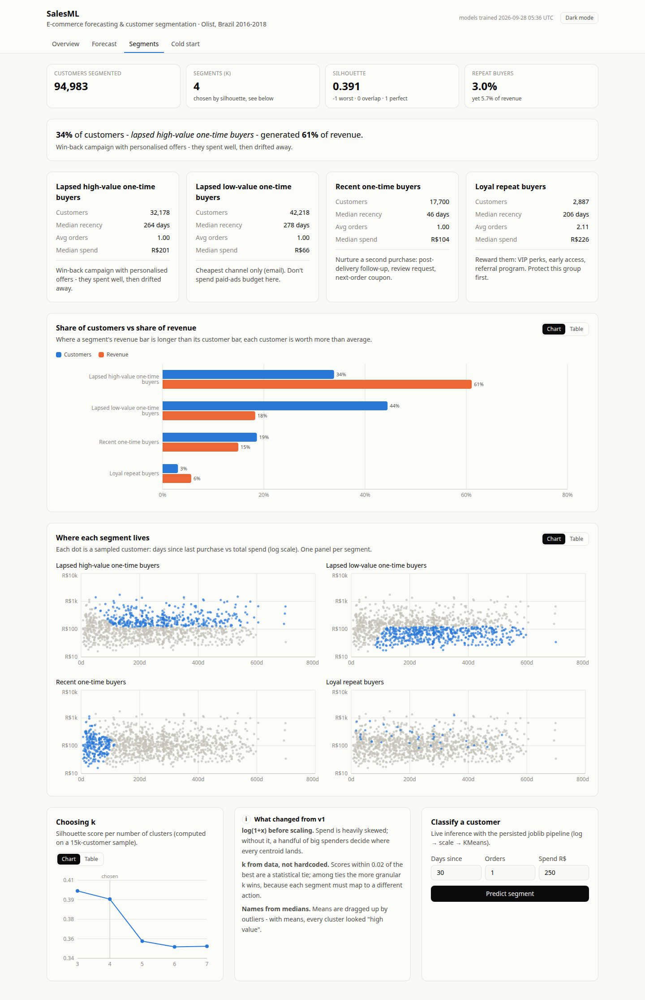
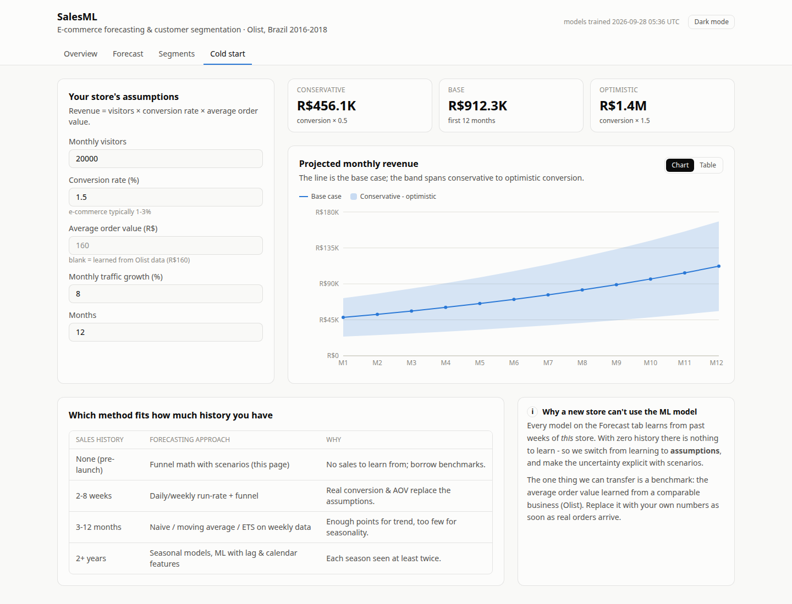
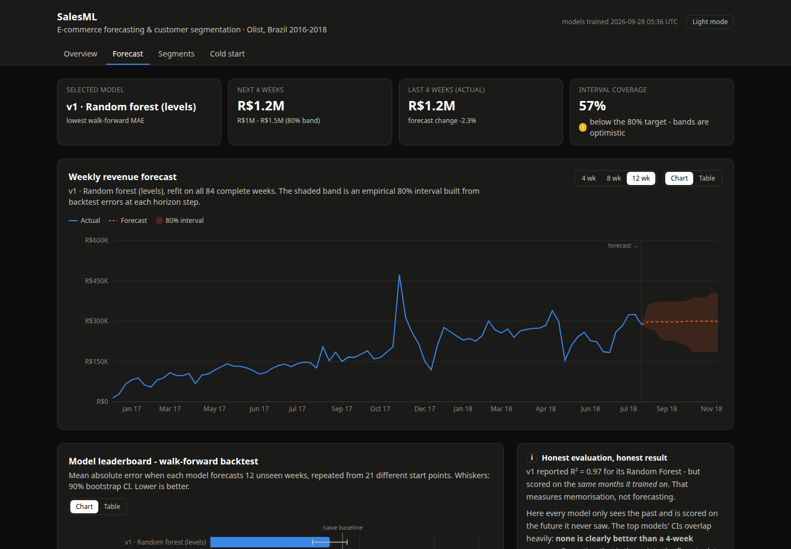

# SalesML — E-commerce Sales Forecasting & Customer Segmentation

An end-to-end machine-learning project on real e-commerce data (Olist, Brazil, 2016–2018):
a reproducible **training pipeline** (Python, scikit-learn, managed with `uv`) that persists its models with
**joblib**, a **Flask API** that serves them, and a **React + Tailwind** dashboard that explains every result.

It answers two business questions:

- **How much will we sell in the coming weeks?** → weekly revenue forecasting with uncertainty bands
- **Who are our customers and what should we do about each group?** → RFM segmentation with an action playbook

…and a third one most tutorials skip: **what if the store is brand new and has no history?** → cold-start estimator.



---

## Table of contents

1. [Headline results](#1-headline-results)
2. [Screenshots](#2-screenshots)
3. [Quick start](#3-quick-start)
4. [Project structure](#4-project-structure)
5. [The pipeline, step by step](#5-the-pipeline-step-by-step)
   - [5.1 Data acquisition](#51-data-acquisition)
   - [5.2 Cleaning with an audit trail](#52-cleaning-with-an-audit-trail)
   - [5.3 Weekly aggregation](#53-weekly-aggregation)
   - [5.4 Detecting the complete data window](#54-detecting-the-complete-data-window)
   - [5.5 Forecasting: candidate models](#55-forecasting-candidate-models)
   - [5.6 Walk-forward backtesting](#56-walk-forward-backtesting)
   - [5.7 Metrics and confidence intervals](#57-metrics-and-confidence-intervals)
   - [5.8 Prediction intervals](#58-prediction-intervals)
   - [5.9 Customer segmentation](#59-customer-segmentation)
   - [5.10 Cold-start estimator](#510-cold-start-estimator)
   - [5.11 Persisting the pipeline with joblib](#511-persisting-the-pipeline-with-joblib)
6. [The API](#6-the-api)
7. [The frontend](#7-the-frontend)
8. [Tests](#8-tests)
9. [What v2 fixed (and why it matters)](#9-what-v2-fixed-and-why-it-matters)
10. [Limitations — read before quoting numbers](#10-limitations--read-before-quoting-numbers)
11. [Ideas for extending it](#11-ideas-for-extending-it)
12. [Interview talking points](#12-interview-talking-points)
13. [Glossary](#13-glossary)

---

## 1. Headline results

| | Result |
|---|---|
| Data | 98,199 real orders, 94,983 unique customers, R$ 15.7M revenue |
| Usable history | 84 complete weeks (2017-01-09 → 2018-08-13), detected automatically |
| Models compared | 9 (baselines, classical statistics, ML), 21 walk-forward folds × 12-week horizon |
| Best model | MAE R$ 40.0k/week (≈17.5% MAPE), 9.7% better than a naive forecast |
| Honest finding | The top 6 models' confidence intervals overlap — **no model is clearly better than a 4-week average** |
| Segments | 4 (chosen by silhouette); **34% of customers generate 61% of revenue** |
| Interval coverage | 57% on held-out folds vs an 80% target — the app flags this instead of hiding it |

The biggest lesson of the project: **fixing the data and the evaluation mattered far more than choosing a
fancier model.** The original version (v1) reported R² = 0.97; measured honestly, its model is only
marginally better than "next week = last week". See [section 9](#9-what-v2-fixed-and-why-it-matters).

---

## 2. Screenshots

All four pages of the dashboard, in light mode (the app also has a dark mode, shown at the end). Every chart
has a **Chart ⇄ Table** toggle, so each value can also be read as plain numbers.

### Overview — data quality first

KPIs, weekly revenue with the automatically excluded edge weeks in grey, and the cleaning audit showing what
each step removed and why.



### Forecast — honest evaluation

The winning model's 12-week forecast with its 80% interval band, the leaderboard of all 9 models with bootstrap
confidence-interval whiskers and the naive baseline, and how error grows with the forecast horizon.


### Segments — who the customers are and what to do

The headline insight, one card per segment with its recommended action, customer share vs revenue share, one
scatter panel per segment, the silhouette curve used to choose k, and a live form that classifies a customer
with the saved joblib pipeline.



### Cold start — when there is no history

Funnel-math scenarios (visitors × conversion × order value) that recalculate as you type, plus which
forecasting method fits how much sales history a store has.



### Dark mode

Colours are separate light and dark palettes, each checked for colour-blind safety, not an automatic inversion.



---

## 3. Quick start

**Prerequisites:** [uv](https://docs.astral.sh/uv/) (manages Python *and* dependencies — no manual venv) and
Node.js 20.19+ or 22.12+ (required by Vite 8).

```bash
# 1) Backend: install, download data, train, serve
cd backend
uv sync                 # creates .venv and installs the exact locked versions from uv.lock
uv run fetch-data       # downloads the Olist dataset from Kaggle (no account needed) -> backend/data/raw/
uv run train            # runs the whole pipeline (~20 s) -> backend/artifacts/
uv run serve            # Flask API on http://127.0.0.1:5000

# 2) Frontend (new terminal)
cd frontend
npm install
npm run dev             # http://localhost:5173  (proxies /api to Flask)
```

Other useful commands:

```bash
cd backend && uv run pytest              # 21 tests
cd frontend && npm run lint              # oxlint
cd frontend && npm run build             # type-check + production build
curl -X POST localhost:5000/api/reload   # hot-swap models after re-training, no restart
```

`uv run <name>` works because `pyproject.toml` declares console scripts:
`fetch-data → salesml.data:main`, `train → salesml.train:main`, `serve → salesml.api:main`.

---

## 4. Project structure

```
.
├── backend/                       Python package "salesml" (managed by uv)
│   ├── pyproject.toml             dependencies, console scripts, pytest config
│   ├── uv.lock                    exact pinned versions -> reproducible installs
│   ├── .python-version            Python 3.12 (uv downloads it if missing)
│   ├── src/salesml/
│   │   ├── config.py              every tunable in one place (paths, thresholds, horizon, seeds)
│   │   ├── data.py                fetch, clean (+ audit log), weekly aggregation, window detection
│   │   ├── forecasting.py         9 forecasters, backtesting, metrics, intervals, ForecastBundle
│   │   ├── segmentation.py        RFM table, sklearn Pipeline, k selection, naming, SegmentBundle
│   │   ├── coldstart.py           funnel-math scenarios for stores with no history
│   │   ├── train.py               orchestrates everything and writes the artifacts
│   │   └── api.py                 Flask app factory + endpoints
│   ├── tests/                     pytest suite (data, forecasting, segmentation, API)
│   ├── data/raw/                  downloaded CSVs            (git-ignored, reproducible)
│   └── artifacts/                 forecast.joblib, segments.joblib, report.json (git-ignored)
├── frontend/                      React 19 + TypeScript + Vite + Tailwind CSS v4 + Recharts
│   ├── vite.config.ts             Tailwind plugin + dev proxy /api -> :5000
│   └── src/
│       ├── api.ts                 typed API client (types mirror the Flask responses)
│       ├── useApi.ts              small data-fetching hook
│       ├── format.ts              currency / number / date formatting
│       ├── index.css              design tokens: validated chart palette, light & dark themes
│       ├── components/            Card, StatTile, ChartCard (chart ⇄ table), tooltip, chart styles
│       └── pages/                 Overview, Forecast, Segments, ColdStart
└── docs/screenshots/
```

Why this layout:

- **`src/` layout** — the package is only importable after installation, so tests run against the package
  exactly as it would be deployed, not against loose files that happen to be on the path.
- **Training and serving are separate processes.** `train` writes artifacts; `serve` only reads them.
  A web request never triggers training — that is the core idea of an ML *pipeline* vs a notebook.
- **`config.py`** holds every magic number, so an experiment ("what if the horizon were 8 weeks?") is a
  one-line change and nothing is hidden inside functions.

---

## 5. The pipeline, step by step

```
fetch ─► clean + audit ─► weekly revenue ─► detect complete window ─┬─► backtest 9 models ─► select + intervals ─► forecast.joblib
                                                                    │
                                     customer RFM table ◄───────────┴─► log → scale → KMeans ─► name segments ─► segments.joblib
                                                                                                   report.json (audit, KPIs, hashes)
```

Each stage is a plain, tested Python function, and the whole thing is reproducible from two commands
(`uv run fetch-data` and `uv run train`):

| # | Stage | What happens | Code |
|---|---|---|---|
| 1 | Fetch | `kagglehub` download of the public Olist dataset | `uv run fetch-data` → `data.fetch()` |
| 2 | Clean + audit | drop non-sales, deduplicate on keys, validate amounts — every step logged | `data.clean()` |
| 3 | Aggregate | revenue = price + freight, summed into Monday-starting weeks | `data.weekly_revenue()` |
| 4 | Detect window | trim the sparse start and the half-extracted tail automatically | `data.find_complete_window()` |
| 5 | Backtest | 9 models × 21 walk-forward folds × 12-week horizon | `forecasting.backtest()` |
| 6 | Select + calibrate | lowest MAE wins; prediction intervals from backtest residuals | `forecasting.train_forecaster()` |
| 7 | Segment | RFM → log → scale → KMeans as one sklearn `Pipeline` | `segmentation.train_segmentation()` |
| 8 | Persist | joblib bundles + `report.json` with data hashes and library versions | `uv run train` → `train.run()` |
| 9 | Serve | Flask loads the artifacts once and never trains on a request | `uv run serve` → `api.create_app()` |

### 5.1 Data acquisition

`data.fetch()` uses [`kagglehub`](https://github.com/Kaggle/kagglehub) to download the public
[Olist dataset](https://www.kaggle.com/datasets/olistbr/brazilian-ecommerce) (anonymous download works for
public datasets) and copies the three files we need into `backend/data/raw/`:

| File | Used for |
|---|---|
| `olist_orders_dataset.csv` | order status and purchase timestamp |
| `olist_order_items_dataset.csv` | price and freight per item |
| `olist_customers_dataset.csv` | `customer_unique_id` — the real person behind each order |

Why `customer_unique_id` and not `customer_id`? In Olist every *order* gets a new `customer_id`. Using it
would make every customer look like a one-time buyer. `customer_unique_id` links orders by the same person.

### 5.2 Cleaning with an audit trail

`data.clean()` returns the cleaned rows **and** a list describing every step: rows before, rows after, how
many were removed and why. The dashboard shows it as a table. A silent `dropna()` hides decisions; an audit
log makes them reviewable.

| Step | What / why |
|---|---|
| Join orders + items | 775 orders have no items at all (mostly `unavailable`) → no revenue to count |
| Drop `canceled` / `unavailable` | 549 items, R$ 108k that never became sales. v1 counted these as revenue |
| Parse dates (`format="ISO8601"`) | unparseable dates become `NaT` and are dropped instead of crashing |
| Deduplicate on `(order_id, order_item_id)` | the real key of an item row — not "all columns identical" |
| Validate amounts | price > 0, freight ≥ 0 |
| Attach customers | adds `customer_unique_id` and state |
| **Flag, don't drop,** extreme prices | 113 items above the 99.9th percentile are *kept*. They are real sales; v1 deleted the top 1% of prices, which removed ~12% of all revenue |

**Revenue = price + freight.** This matches `olist_order_payments_dataset.csv` exactly (median difference
R$ 0.00), i.e. it is what the customer actually paid.

### 5.3 Weekly aggregation

`data.weekly_revenue()` sums revenue into Monday-starting weeks (`resample("W-MON", label="left", closed="left")`).

Why weekly and not monthly (as v1 did)? The data spans ~20 usable months. **20 data points is too few** to
both train a model and test it on several unseen periods. Weekly gives 84 points — enough for 21 honest
backtest folds. Daily would give more points but is dominated by day-of-week noise and the Black Friday spike.

### 5.4 Detecting the complete data window

The export has broken edges:

- **Start:** a tiny pilot in Sep–Oct 2016, then almost nothing in Nov–Dec 2016.
- **End:** orders were still being extracted when the snapshot was taken — daily revenue decays from
  ~R$ 40k to ~R$ 0 over the last two weeks of Aug 2018, and Sep 2018 contains one order.

If a model trains on that tail, it "learns" that sales are collapsing. **This is the main reason v1's Random
Forest forecast ~R$ 180k/month when real months were ~R$ 800k.**

`data.find_complete_window()` finds the clean span from the data itself instead of hardcoding dates:

1. **Start** = the week after the last near-empty week (< 5% of the median week) in the first half.
2. **End** = walk backwards from the last week while it is below 60% of the median of the 8 weeks before it.

Result: **2017-01-09 → 2018-08-13 (84 weeks)**; 22 edge weeks are excluded (grey in the Overview chart).
Because it is data-driven, the same code keeps working if the dataset is refreshed.

### 5.5 Forecasting: candidate models

Every forecaster implements the same two-method interface, so the evaluation code treats all of them the same:

```python
model.fit(y)          # y: pandas Series of weekly revenue, oldest first
model.predict(h)      # numpy array with the next h weeks
```

| Model | Idea | Why it's included |
|---|---|---|
| **Naive** | next weeks = last week | *the* baseline; a model that can't beat this is useless |
| **Moving average (4w)** | mean of the last 4 weeks | naive with less noise |
| **Drift** | last week + average historical weekly change | simplest trend model |
| **v1 · Linear trend** | straight line through time | v1's first model, re-evaluated honestly |
| **v1 · Random forest (levels)** | trees on (time index, month, year) → revenue | v1's second model, re-evaluated honestly |
| **Holt damped trend (ETS)** | exponential smoothing of level + a trend that fades out | classic statistical method (statsmodels) |
| **Ridge on growth lags** | linear model predicting week-over-week *growth* | ML that can extrapolate |
| **GBM on growth lags** | gradient boosting predicting growth | tree ML that can extrapolate |
| **Combo** | average of MA4 + Holt + Ridge-growth | forecast combination (M-competition finding) |

**Why trees can't extrapolate, and the growth-rate fix.** A decision tree predicts the *average target of a
leaf* — so a Random Forest can never output a value higher than anything it saw in training. On a growing
business that guarantees under-forecasting. `GrowthLagForecaster` fixes this by changing the target:

```
g_t = log(y_t) − log(y_{t−1})          # week-over-week log growth, a stationary-ish quantity
features for g_t: g_{t−1..t−4} and their mean
forecast: y_{T+k} = y_T · exp(g_{T+1} + … + g_{T+k})   # compound predicted growth onto the last level
```

Multi-step forecasts are **recursive**: each predicted growth rate is fed back in as a lag for the next step.
A unit test proves the difference: on a series growing 3%/week, the forest stays below the last value while
the growth model keeps climbing at ~3%/week.

### 5.6 Walk-forward backtesting

v1 scored its models on **the same months they were trained on** (in-sample R²). That measures memorisation:
a Random Forest can memorise 25 points almost perfectly, hence R² = 0.97.

`forecasting.backtest()` simulates real use instead — an **expanding-window walk-forward** evaluation:

```
origin 52:  train [wk 1 ............ wk 52]  → forecast wk 53-64, compare with actuals
origin 53:  train [wk 1 ............. wk 53] → forecast wk 54-65
   ...
origin 72:  train [wk 1 ..................... wk 72] → forecast wk 73-84
```

- The model is **refit from scratch at every origin**, seeing only data *before* it. No future leakage — a
  dedicated test (`test_backtest_trains_only_on_the_past`) proves it.
- 21 origins × 12 horizon steps = 252 forecast/actual pairs per model.
- The first origin needs 52 weeks of history (one full year).

Why not a random train/test split or k-fold? Shuffling time series lets the model train on the future and
test on the past — leakage that inflates scores.

### 5.7 Metrics and confidence intervals

| Metric | Meaning | Why |
|---|---|---|
| **MAE** | mean \|actual − forecast\| in R$ | easy to explain; used to choose the winner |
| **RMSE** | root mean squared error | punishes big misses more |
| **MAPE** | mean \|error\| / actual, in % | scale-free |
| **Bias** | mean (actual − forecast) | negative = systematically over-forecasts |
| **Skill vs naive** | 1 − MAE / MAE_naive | "how much better than doing nothing clever" |

**Bootstrap CI on MAE.** Is 40.0k really better than 42.1k? `mae_confidence_interval()` resamples the 21 folds
with replacement 1,000 times and takes the 5th–95th percentile of the resampled MAEs. It resamples **whole
folds**, not individual points, because the 12 errors inside a fold are correlated — resampling them one by
one would make the interval falsely narrow.

Result: the intervals of the top 6 models overlap heavily, so the ranking among them is mostly noise. The
winner is still picked by lowest MAE (a simple, transparent rule), and the UI shows the overlap.

**Why do the ML growth models lose?** 2017 grew fast; 2018 was flat. Models that learn growth extrapolate
2017's momentum into 2018 and over-forecast (bias −R$ 53k to −R$ 61k/week). Level-based models happen to
suit a plateau. That is a *regime change* — a real forecasting risk worth flagging, not a bug to tune away.

### 5.8 Prediction intervals

A point forecast alone hides uncertainty. `interval_quantiles()` builds an **empirical (split-conformal
style) 80% interval** from the winner's backtest errors:

1. For every backtest pair compute `log(actual / forecast)` — in log space the band scales with the forecast
   level and can be asymmetric.
2. For each horizon step (1…12 weeks ahead) take the 10th and 90th percentiles of those log-ratios.
3. Force the band to widen with the horizon (`cummin` / `cummax`) — uncertainty can't shrink further out.
4. Band = `forecast × exp(q_low) … forecast × exp(q_high)`.

**Coverage check.** `interval_coverage()` calibrates the band on the *earlier* half of the folds and measures
how often actuals from the *later* half land inside. Target 80%, measured **57%**: the 2018 plateau behaved
differently from 2017, so bands learned partly on 2017 errors are too narrow. The UI shows a warning badge
rather than pretending the band is calibrated.

### 5.9 Customer segmentation

**RFM** per customer (`customer_unique_id`), measured from the day after the last order in the data:

- **Recency** — days since last purchase
- **Frequency** — number of distinct orders
- **Monetary** — total revenue

**One scikit-learn `Pipeline`**, so training and inference apply identical preprocessing:

```python
Pipeline([
    ("log",    FunctionTransformer(np.log1p)),   # spend is heavily right-skewed
    ("scale",  StandardScaler()),                # KMeans uses distances → features need equal scale
    ("kmeans", KMeans(n_clusters=k, n_init=10, random_state=42)),
])
```

- **Why `log1p`?** Without it, a few customers who spent R$ 5,000+ dominate the distance calculations and
  pull centroids towards themselves.
- **Choosing k** — silhouette score (how much closer each point is to its own cluster than to the nearest
  other one; −1 bad, 0 overlapping, 1 perfect) for k = 3…7, computed on a 15k-customer sample because
  silhouette is O(n²). Scores: k=3 → 0.397, **k=4 → 0.391**, k=5 → 0.358. Differences under 0.02 are treated
  as a tie, and among tied values the more granular k wins, because each segment must drive a *different*
  action. k=4 splits lapsed customers into high- and low-value, which k=3 lumps together.
- **Naming from medians.** Each cluster is compared with the whole customer base: *Recent* vs *Lapsed*
  (median recency), *high-value* / *low-value* (median spend ≥ 1.5× or ≤ 1/1.5× the overall median), or
  *Loyal repeat buyers* (average orders ≥ 1.5). Medians, not means — spend is so skewed that every
  cluster's *mean* sits above the overall median, which made every cluster look "high value".
- Each name maps to a recommended action in `PLAYBOOK`.

| Segment | Customers | Revenue | Median recency | Median spend |
|---|---|---|---|---|
| Lapsed high-value one-time buyers | 33.9% | **61.1%** | 264 days | R$ 201 |
| Lapsed low-value one-time buyers | 44.4% | 18.3% | 278 days | R$ 66 |
| Recent one-time buyers | 18.6% | 15.0% | 46 days | R$ 104 |
| Loyal repeat buyers | 3.0% | 5.7% | 206 days | R$ 226 |

Important context: **97% of customers bought exactly once**, so Frequency barely varies. The segmentation is
driven mostly by recency and spend. The business insight: the money sits in *lapsed high-value* customers —
a win-back campaign target.

**Live inference.** `POST /api/segments/predict` feeds a new (recency, frequency, monetary) through the
persisted pipeline. It also returns an *affinity* per segment: a softmax over negative distances to each
centroid. It is a readable "how close to each group" signal, **not a calibrated probability**.

### 5.10 Cold-start estimator

Every forecasting model above needs this store's past sales. A brand-new store has none, so ML is not
applicable — you switch from *learning* to *assumptions*, and make the uncertainty explicit:

```
monthly revenue = visitors × conversion rate × average order value
```

`coldstart.estimate()` runs this for 1–36 months with optional traffic growth, as three scenarios
(conversion × 0.5 / × 1 / × 1.5). If you don't supply an average order value, the API borrows the one
learned from Olist (R$ 160) — a simple form of **transferring a benchmark from a comparable business**.
The page also shows which forecasting approach fits how much history you have.

### 5.11 Persisting the pipeline with joblib

`uv run train` writes three artifacts:

| File | Contents |
|---|---|
| `forecast.joblib` | `ForecastBundle`: the fitted winning model, the training history, excluded weeks, interval quantiles, leaderboard, per-horizon errors, coverage |
| `segments.joblib` | `SegmentBundle`: the fitted sklearn `Pipeline`, silhouette scores, names, profile, a scatter sample |
| `report.json` | cleaning audit, KPIs, the data window, and **run metadata**: timestamp, SHA-256 of each input file, Python/pandas/scikit-learn versions, stage timings |

Why bundle everything into one dataclass instead of saving only the model? Inference needs more than the
estimator — the interval quantiles, the date of the last training week, the names of clusters. Keeping them
together means they can never get out of sync.

Why record hashes and versions? So any number in the dashboard can be traced to exact inputs and code, which
is the basis of reproducibility. The metadata block of a real run looks like this (hashes are the first 16
hex characters of each file's SHA-256):

```json
"window":   { "start": "2017-01-09", "end": "2018-08-13", "weeks_used": 84, "weeks_excluded": 22 },
"metadata": {
  "trained_at": "2026-09-28T05:36:40+00:00",
  "data_sha256": { "orders": "8df58ef3d2d7e994", "items": "0bc4d068c4fe38cb", "customers": "983a422239e1712d" },
  "python": "3.12.3", "pandas": "3.0.6", "scikit_learn": "1.9.1",
  "timings_s": { "data_s": 0.66, "forecast_s": 4.75, "segments_s": 16.25 }
}
```

If you re-download the data and a hash changes, the source data changed — so results may differ. Timings
show where training time goes: segmentation dominates because silhouette scoring is O(n²).

Two caveats worth knowing:

- **joblib/pickle files execute code when loaded.** Only load artifacts you produced yourself.
- A pickle generally needs the **same library versions** to load. `uv.lock` pins them, which is why the lock
  file is committed.

---

## 6. The API

Flask app factory in `api.py`. Artifacts are loaded **once** at startup; if they are missing, endpoints
return `503` with a message telling you to run `uv run train`. Invalid input returns `400` with the field name.

| Method | Endpoint | Returns |
|---|---|---|
| GET | `/api/health` | status, whether artifacts are loaded, training timestamp |
| POST | `/api/reload` | reloads artifacts from disk (after re-training, no restart) |
| GET | `/api/overview` | KPIs, cleaning audit, window, run metadata, weekly series (used/excluded) |
| GET | `/api/forecast?horizon=1..12` | history, forecast with bands, leaderboard, per-horizon MAE, 4-week summary |
| GET | `/api/segments` | k, silhouette curve, segment profiles + actions, scatter sample |
| POST | `/api/segments/predict` | segment, action and affinity for `{recency_days, frequency, monetary}` |
| POST | `/api/coldstart` | monthly scenarios for `{monthly_visitors, conversion_rate_pct, average_order_value?, monthly_traffic_growth_pct?, months?}` |

```bash
curl "localhost:5000/api/forecast?horizon=4"
curl -X POST localhost:5000/api/segments/predict -H 'Content-Type: application/json' \
     -d '{"recency_days": 30, "frequency": 1, "monetary": 250}'
curl -X POST localhost:5000/api/coldstart -H 'Content-Type: application/json' \
     -d '{"monthly_visitors": 20000, "conversion_rate_pct": 1.5, "monthly_traffic_growth_pct": 8}'
```

`to_json()` converts pandas/numpy output into valid JSON (timestamps → ISO dates, NaN → `null`,
numpy scalars → Python numbers). Flask would otherwise emit `NaN`, which is not valid JSON.

---

## 7. The frontend

React 19 + TypeScript + Vite + Tailwind CSS v4 + Recharts. Four tabs:

| Tab | Shows |
|---|---|
| **Overview** | KPIs, weekly revenue with excluded edge weeks in grey, the cleaning audit |
| **Forecast** | forecast + 80% band (4/8/12-week horizon), leaderboard with CI whiskers, error growth by horizon |
| **Segments** | headline insight, segment cards with actions, customers-vs-revenue share, one scatter panel per segment, the silhouette curve, a live "classify a customer" form |
| **Cold start** | interactive funnel scenarios + which method fits how much history |

Design decisions:

- **Every chart has a table view** (Chart ⇄ Table toggle). Values are never readable only by hover or by colour.
- **Colour palette validated for colour-blindness** in light and dark mode. Only 3 categorical colours are
  used per chart (the validated all-pairs limit). That is why the 4 segments are drawn as small multiples —
  one highlighted segment over grey — instead of 4 colours in one scatter.
- **Dark mode** follows the OS setting and can be toggled. Colours are CSS variables in `index.css`, so charts
  and Tailwind classes share one source of truth.
- **In development, Vite proxies `/api` to Flask**, so the browser sees one origin (no CORS setup needed).
  Flask also allows CORS from `localhost:5173` for other setups.
- `useApi(load, key)` keeps showing the previous data while a new horizon loads (dimmed), instead of
  flashing a loading skeleton, and ignores responses from superseded requests.

---

## 8. Tests

`uv run pytest` — 21 tests, ~4 s, no network and no dataset needed (they use synthetic data):

| Test | Proves |
|---|---|
| `test_clean_removes_non_sales_and_bad_rows` | canceled orders, duplicate keys and bad dates are removed; revenue = price + freight; audit adds up |
| `test_clean_keeps_expensive_items` | extreme prices are kept, not deleted |
| `test_complete_window_*` | window detection trims a sparse start and a decaying tail, and leaves a clean series alone |
| `test_backtest_trains_only_on_the_past` | **no data leakage** — every fit ends strictly before its forecast origin |
| `test_growth_model_extrapolates_where_level_forest_cannot` | the tree-extrapolation bug and its fix, demonstrated |
| `test_every_candidate_returns_a_finite_forecast` | all 9 models work through the common interface |
| `test_interval_quantiles_widen_with_horizon` | bands contain the forecast and never shrink further out |
| `test_forecast_bundle_end_to_end` | training → bundle → forecast with bands and correct dates |
| `test_segmentation_names_and_joblib_roundtrip` | a joblib-reloaded pipeline predicts identically; names and affinities are sane |
| `test_coldstart_*`, `test_api_*` | scenario maths, 400 on bad input, 503 when artifacts are missing |

Writing these tests caught two real bugs: a crash when no order lacked items, and pandas silently turning
mixed-format dates into `NaT` (fixed with `format="ISO8601"`).

---

## 9. What v2 fixed (and why it matters)

v1 was four scripts (`clean.py`, `analysis.py`, `forecasting.py`, `update_forecasting.py`). Running them
reproduced their README numbers exactly — the problems were in *what* was measured, not in the arithmetic.

| v1 issue | Consequence | v2 fix | Impact |
|---|---|---|---|
| R² computed on training data | 0.97 measured memorisation; re-scored on its last 6 unseen months, the same v1 model got R² ≈ −0.26 (worse than predicting the average) | walk-forward backtest + naive baseline + bootstrap CIs | real error visible; the claimed superiority disappears |
| Partial months at both ends (last month R$ 145) | RF forecast ~R$ 180k/month vs ~R$ 800k real | data-driven complete-window detection | forecast no longer collapses to ~R$ 180k/month |
| Canceled/unavailable orders counted | revenue overstated | filtered by `order_status` | revenue reflects real sales |
| Top 1% prices removed as "outliers" | ~12% of real revenue deleted | flag, keep | ~12% of revenue restored |
| Freight ignored | revenue ≠ what customers paid | revenue = price + freight | ties out to what customers paid |
| Monthly data (~20 points), seasonality claimed | can't test honestly; seasonality needs ≥ 2 full years | weekly data; no seasonality claims | enough folds (21) to evaluate honestly |
| Trees on raw levels | can't forecast above past values | growth-rate models compared side by side | the trade-off is measured, not assumed |
| No uncertainty | a single number looks falsely precise | empirical intervals + coverage check | forecast band + honest calibration warning |
| k = 4 hardcoded, raw skewed RFM | outliers drive clusters, unnamed segments | log1p, silhouette selection, median-based names, actions | actionable, named segments |
| Nothing persisted | everything recomputed on every run | joblib artifacts + API | train once, serve many times |
| UTF-16 `.gitignore` | git couldn't read it, so data would be committed | UTF-8 `.gitignore` | data and models stay out of git |
| No dependency pinning | "works on my machine" | `uv.lock` | reproducible installs |

---

## 10. Limitations — read before quoting numbers

- **Small sample.** 84 weeks and 21 folds. Differences between the top models are within noise (see the CIs).
- **Selection bias.** The winner is picked as the best of 9 on the same backtest it is scored on, so its
  MAE is slightly optimistic. A stricter setup would hold out a final untouched period.
- **Intervals under-cover** (57% vs 80%) because of the 2017 → 2018 regime change.
- **No seasonality or holidays.** Less than two years of clean data; Black Friday 2017 appears once and
  cannot be learned. The forecast horizon (to Nov 2018) stops just before Black Friday 2018.
- **The data is historical** (2016–2018). "Next 4 weeks" means the 4 weeks after the data ends.
- **Segment affinity is a distance-based score**, not a probability.
- **The dev servers are not production servers.** For deployment use a WSGI server (e.g. gunicorn) and
  `npm run build` for static files.

---

## 11. Ideas for extending it

- A holiday / Black Friday feature, and a seasonal model once ≥ 2 years of data exist
- Hierarchical forecasts per product category or state, reconciled to the total
- Hold out a final test period to remove selection bias; add a Diebold-Mariano test between models
- Conformalized quantile regression for better-calibrated intervals
- Use review scores and delivery delays (other Olist files) to predict churn and repeat purchase
- Track experiments with MLflow; schedule retraining; add drift checks comparing new data with training data
- Dockerfile + GitHub Actions running `pytest`, `oxlint` and the build

---

## 12. Interview talking points

1. **"My first model reported R² 0.97 — here's why that was wrong."** In-sample vs out-of-sample evaluation,
   and how walk-forward backtesting fixes it.
2. **Data problems beat model problems.** Canceled orders, deleted outliers and a half-extracted final month
   distorted results more than any model choice.
3. **Why tree models can't extrapolate** and how predicting growth rates instead of levels fixes it.
4. **Reporting a negative result.** Fancy ML didn't beat simple baselines during a plateau; bootstrap CIs
   show when a ranking is just noise.
5. **Uncertainty.** Empirical prediction intervals, and checking their coverage on held-out data.
6. **Train/serve separation.** One sklearn `Pipeline` persisted with joblib, versioned with data hashes, and
   served by an API that never trains.
7. **Knowing when ML is not the answer** — the cold-start page.

---

## 13. Glossary

| Term | Meaning |
|---|---|
| **Backtest** | evaluating a forecaster on past periods it was not trained on, as if in production |
| **Walk-forward / expanding window** | repeat the backtest from many start points, each time training on everything before |
| **Horizon** | how many steps ahead a forecast looks (here 1–12 weeks) |
| **Data leakage** | information from the future (or the test set) sneaking into training, inflating scores |
| **In-sample** | measured on the training data (optimistic); **out-of-sample** = on unseen data (honest) |
| **Baseline** | the simplest reasonable model; any real model must beat it |
| **MAE / RMSE / MAPE** | average absolute error / root-mean-squared error / average percentage error |
| **Bootstrap** | resampling with replacement to estimate how much a statistic could vary |
| **Prediction interval** | a range expected to contain the actual value with a stated probability (here 80%) |
| **Coverage** | how often actuals really fall inside the interval |
| **Regime change** | the process generating the data changes (e.g. growth → plateau) |
| **ETS / Holt** | exponential smoothing: weighted averages that favour recent data, with a level and trend |
| **Recursive forecasting** | predict one step, feed that prediction back in to predict the next |
| **RFM** | Recency, Frequency, Monetary — the classic customer-value features |
| **KMeans** | clustering that assigns points to the nearest of k centroids and moves the centroids to the cluster means |
| **Silhouette score** | cluster quality from −1 to 1: own-cluster closeness vs nearest other cluster |
| **sklearn Pipeline** | chains preprocessing and model so they are fitted, saved and applied together |
| **joblib** | efficient serialization of Python objects (especially numpy-heavy models) to disk |
| **Cold start** | making predictions for a new entity (store, user) with no history |

---

**Dataset:** [Brazilian E-Commerce Public Dataset by Olist](https://www.kaggle.com/datasets/olistbr/brazilian-ecommerce) (CC BY-NC-SA 4.0).
